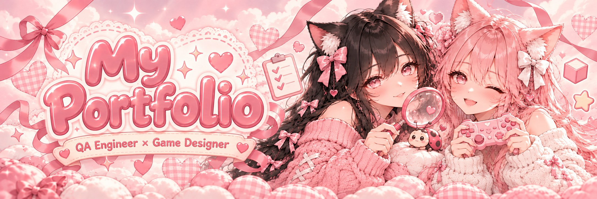
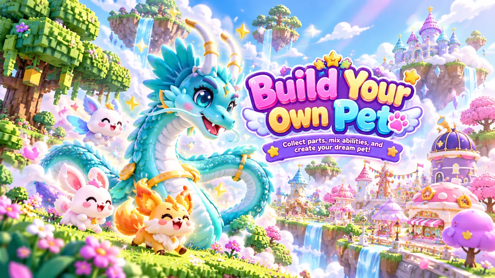
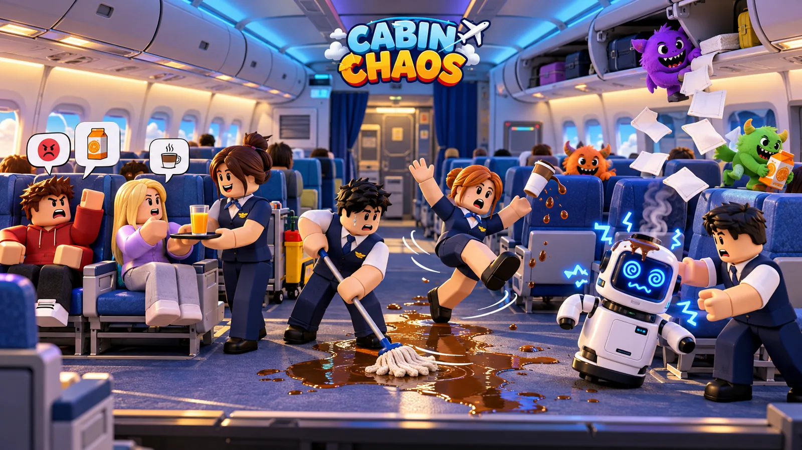
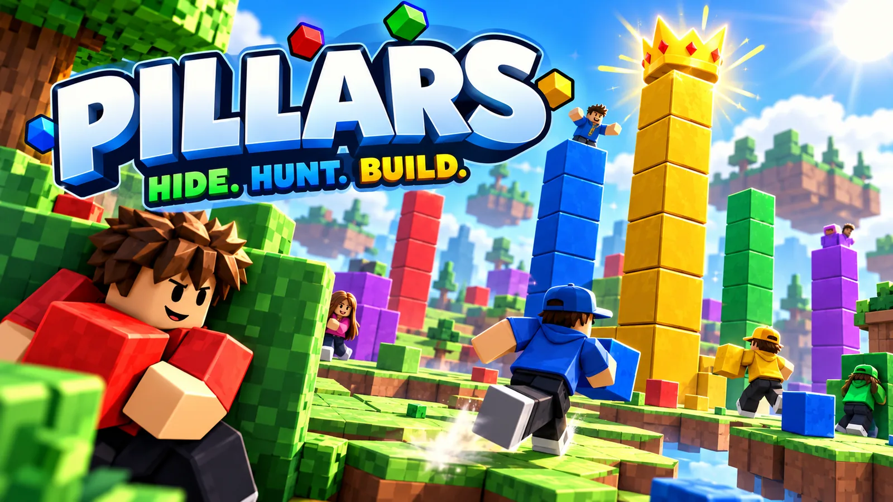
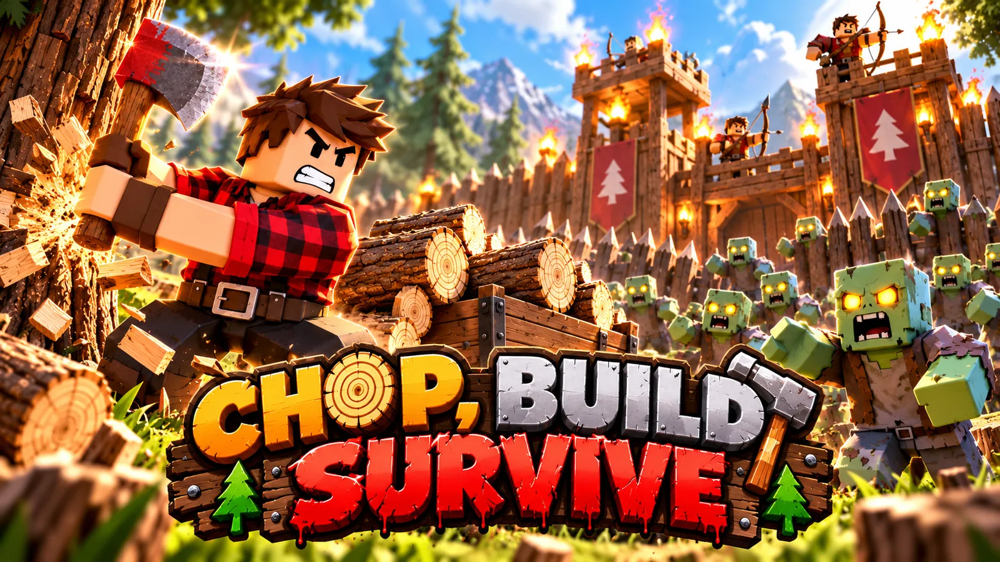
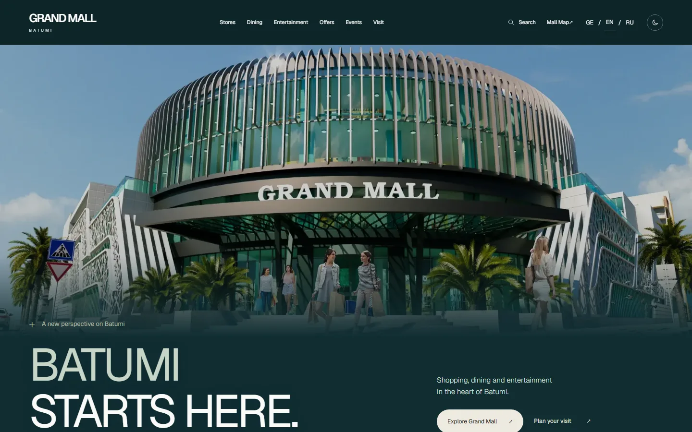
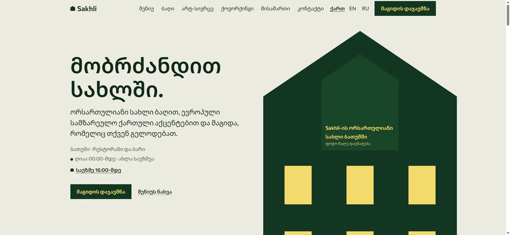
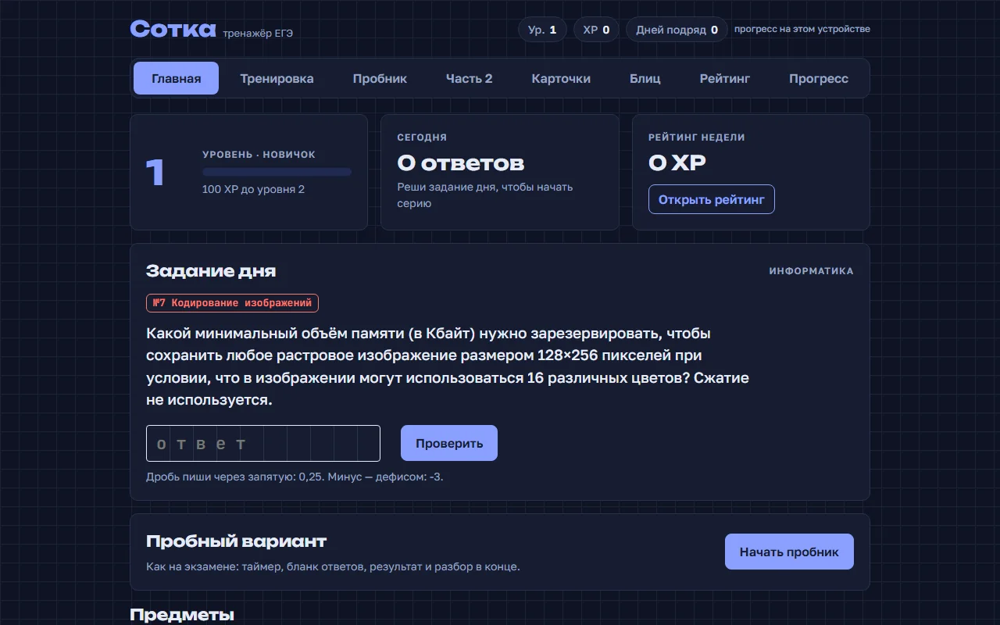

<div align="center">



<a href="https://sofia-stetsiuk-portfolio.vercel.app/en"></a>
<a href="https://sofia-stetsiuk-portfolio.vercel.app/en#showroom"></a>
<a href="https://github.com/silestiari"></a>


</div>

<p align="center">⋆｡ﾟ☁︎｡⋆｡ ﾟ☾ ﾟ｡⋆ &nbsp; =^･ω･^= &nbsp; ⋆｡ﾟ☁︎｡⋆｡ ﾟ☾ ﾟ｡⋆</p>

## 🎀 About

My personal portfolio site: **QA Engineer × Game Designer** from Batumi, Georgia. It shows seven projects (three web projects where QA was part of the process from day one, and four Roblox games where I design the systems and test every build), a 3D gallery of my Blender models, and a few small things to play with. I set the tasks, made the design decisions and did the QA.

## 🎮 Projects inside

<table>
<tr>
<td width="25%"><br/><b>Build Your Own Pet</b><br/><sub>Roblox</sub></td>
<td width="25%"><br/><b>Cabin Chaos</b><br/><sub>Roblox</sub></td>
<td width="25%"><br/><b>PILLARS: Hide & Stack</b><br/><sub>Roblox</sub></td>
<td width="25%"><br/><b>Woodcutter vs Zombies</b><br/><sub>Roblox</sub></td>
</tr>
<tr>
<td><br/><b><a href="https://github.com/silestiari/grand-mall">Grand Mall Batumi</a></b><br/><sub>Web · released</sub></td>
<td><br/><b>Sakhli</b><br/><sub>Web · in development</sub></td>
<td><br/><b>Sotka</b><br/><sub>ЕГЭ prep app · prototype</sub></td>
<td align="center"><a href="https://github.com/silestiari/3d-models"><b>🎨 33 free<br/>3D models →</b></a></td>
</tr>
</table>

## ✨ What's on the site

- 🐞 **Hero mini-game**: catch the bugs crawling over the hero by clicking them
- 🗂️ **Projects** with Web / Roblox / AI filters and a case page for each one: my role, stack, features, screenshots and videos
- 🧊 **3D Showroom**: Blender models from Build Your Own Pet in the browser; rotate, zoom, switch Wire / Clay / Final render passes. Falls back to static previews without WebGL
- 🐾 **Build a Pet**: a playable demo of the part-based pet system: mix parts, elements and accessories
- 🛤️ **About** as a journey path: every step is backed by a course, practice or a project
- 🧩 **Skills matrix**: skills are tied to the projects where they were used, not self-ratings
- 🌍 **EN / RU** with the language switch keeping the page and anchor, keyboard-friendly navigation, reduced-motion support

## 🧪 Quality

- **Playwright end-to-end tests** in [`e2e/`](e2e/): routing & SEO, i18n, navigation & contact, accessibility & layout (axe), 3D showroom, pet builder, playgrounds
- `check:i18n` script makes sure EN and RU have the same keys
- Test plan and QA report: [docs/TEST_PLAN.md](docs/TEST_PLAN.md) · [docs/QA_REPORT.md](docs/QA_REPORT.md)
- Architecture and performance notes: [docs/ARCHITECTURE.md](docs/ARCHITECTURE.md) · [docs/PERFORMANCE_REPORT.md](docs/PERFORMANCE_REPORT.md)

## 🚀 Run locally

```bash
npm install
npm run dev          # http://localhost:3000
```

| Command | What it does |
|---|---|
| `npm run lint` | ESLint |
| `npm run typecheck` | TypeScript check |
| `npm run check:i18n` | Compare EN / RU dictionaries |
| `npm run build` | Production build |
| `npm run test:e2e` | Playwright end-to-end tests |

<p align="center">⋆｡ﾟ☁︎｡⋆｡ ﾟ☾ ﾟ｡⋆ &nbsp; =^･ω･^= &nbsp; ⋆｡ﾟ☁︎｡⋆｡ ﾟ☾ ﾟ｡⋆</p>

<div align="center">

🎀 Made by **[Sofia Stetsiuk](https://github.com/silestiari)** · [Telegram](https://t.me/silestiari) · [sofiavipera@gmail.com](mailto:sofiavipera@gmail.com)

<sub>All projects shown are personal or demo work, not commercial client orders.</sub>

</div>
